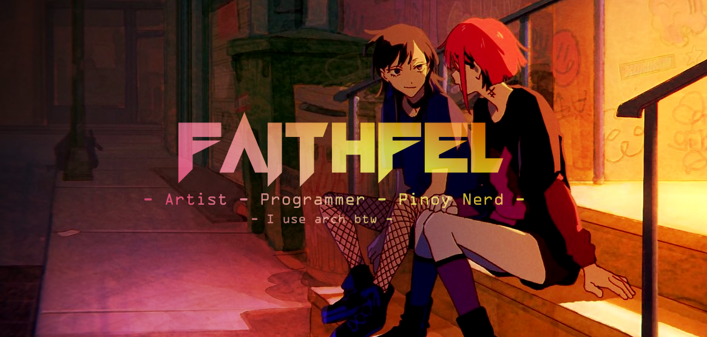
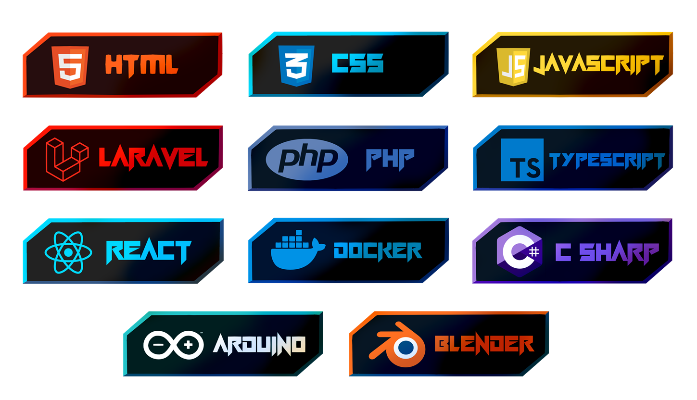

## ⋆˙⟡ About Me ⟡˙⋆

I'm an Aspiring Software Engineer. Currently in my 3rd year of college studying Computer Science.

## ⋆˙⟡ My Tech Stack ⟡˙⋆

## ⋆˙⟡ My Stats ⟡˙⋆

<h6>⋆˙⟡ thanks for scrolling ⟡˙⋆</h6>

